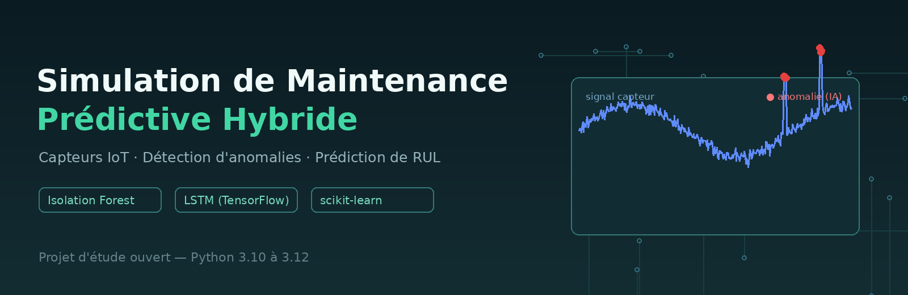
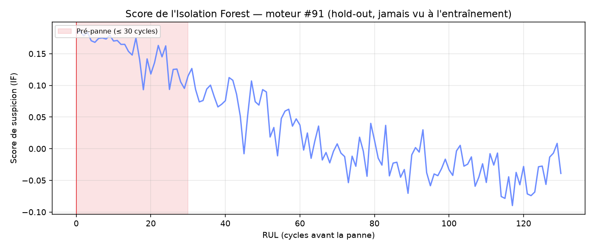

<div align="center">



**Un pipeline complet simulé de maintenance prédictive** — génération
de données capteurs, détection d'anomalies et modélisation de RUL.

[](https://github.com/bindedouworker-hub/simulation-maintenance-predictive/actions/workflows/python-package.yml)
[](LICENSE)


[Français](README.fr.md) · [English](README.md)

*Projet d'étude personnel — ouvert à toutes les améliorations et contributions !*

</div>

---

## 🎯 Ce que le projet fait

Ce projet simule **la chaîne complète de données d'un système de
maintenance prédictive** pour du matériel informatique / électronique
(température CPU, tension VCC, vitesse ventilateur) :

1. **Génération de données** — flux de capteurs synthétiques : signal
   sain (cycle journalier + bruit gaussien) avec **pannes injectées**
   (dérives, pics)
2. **Détection d'anomalies (non supervisée)** — `IsolationForest`
   marque les fenêtres anormales sans aucune donnée étiquetée, enrichie
   d'un **étage résidu saisonnier** pour les dérives persistantes
   (voir Fiabilité)
3. **Prétraitement pour le deep learning** — normalisation Min-Max +
   fenêtres glissantes pour la modélisation de séries temporelles
4. **Modèle LSTM (RUL)** — réseau `LSTM → LSTM → Dense` empilé qui
   estime la **durée de vie restante** (*Remaining Useful Life*)
5. **Évaluation** — matrice de confusion, précision/rappel/F1, avec un
   œil sur les **faux négatifs** (panne ratée = l'erreur la plus coûteuse)

## 🔬 Fiabilité & validation sur données réelles

Signal + anomalies ponctuelles détectées par l'Isolation Forest d'origine
(run seedé, voir `results/simulation_plot.png` et évaluation enregistrée) :

| | Précision | Rappel | F1 |
|---|---|---|---|
| Normal | 0.94 | 0.99 | 0.96 |
| **Anomalie** | **0.84** | **0.42** | **0.56** |

> 93 % d'exactitude stricte — mais un rappel de 0.42 sur l'anomalie :
> exactement le type de constat honnête que ce projet met en évidence,
> puis corrige.

Un détecteur dont les résultats dépendent du tirage ne vaut rien : le
projet embarque un **audit de fiabilité Monte-Carlo**
(`scripts/reliability_audit.py`, 200 exécutions indépendantes) :

| Détecteur | Rappel point (panne 16σ) | Épisodes détectés | Latence d'alarme (méd.) |
|---|---|---|---|
| Isolation Forest seul *(d'origine)* | 0.44 ± 0.02 | 100 % | 0 pt |
| **Hybride : IF + résidu saisonnier** *(construit pendant l'audit)* | **1.00 ± 0.00** | 100 % | 0 pt |

Deux constats structurels issus de cet audit, documentés dans
`results/reliability_report.txt` :

1. **L'Isolation Forest seul plafonne (~0.44) sur les dérives
   *persistantes*** — un plateau décalé n'est pas fait de points
   isolés, et `contamination=0.05` ne peut marquer que 25 points sur
   500 alors que la panne en couvre 50.
2. La réponse est un **détecteur hybride** : l'IF continue d'attraper
   les anomalies ponctuelles, et un étage *résidu saisonnier*
   (`x[i] − x[i−P]`, période P estimée par autocorrélation bornée)
   attrape la dérive — rappel 1.0 dès ~4× l'écart-type du bruit, avec
   une latence quasi nulle. La continuation du décalage sur le cycle
   suivant explique la précision stricte de 0.55 ; en termes
   industriels, ces alertes sont correctes.

La reproductibilité est garantie : tous les tirages sont seedés
(`seed=42` par défaut partout) — deux exécutions produisent exactement
les mêmes résultats.

### Benchmark NASA C-MAPSS FD001 (données réelles du domaine)

`scripts/real_data_benchmark.py` applique la même idée « entraîné sur
le sain, score sur le reste » au dataset NASA Turbofan public
(100 moteurs, 20 631 cycles de capteurs) : IsolationForest ajusté sur
les cycles sains des moteurs 1-80, score des moteurs 81-100 (jamais
vus), détection de la fenêtre pré-panne des 30 derniers cycles :



| Métrique (moteurs hold-out 81-100) | Valeur |
|---|---|
| AUC-ROC (pré-panne vs sain) | **0.984** |
| AUC-PR | **0.923** |
| Moteurs avec phase pré-panne détectée | **20/20** |
| Anticipation de la 1re alarme | **~29 cycles avant la panne** |

Exécutez-le vous-même (dataset téléchargé automatiquement si absent) :

```bash
python scripts/real_data_benchmark.py     # données réelles NASA
python scripts/reliability_audit.py 200   # audit Monte-Carlo
```

## 🚀 Démarrage

```bash
git clone https://github.com/bindedouworker-hub/simulation-maintenance-predictive.git
cd simulation-maintenance-predictive

python -m venv .venv && source .venv/bin/activate
pip install -r requirements.txt
```

Exécuter le pipeline complet :

```bash
python scripts/generate_data.py          # 1. flux de capteurs synthétique
python scripts/maintenance_simulator.py  # 2. détection IsolationForest + plot
python scripts/data_preprocessing.py     # 3. normalisation + fenêtres glissantes
python scripts/evaluation.py             # 4. matrice de confusion + rapport
```

Les sorties vont dans `results/` (flux CSV, rapports texte,
`simulation_plot.png`).

> `scripts/lstm_model.py` définit l'architecture du réseau RUL
> (TensorFlow). Le reste du pipeline fonctionne **sans TensorFlow** :
> vous pouvez explorer détection/évaluation sans installation lourde.

## 🗂️ Structure du projet

```
.
├── data/                       # données de capteurs générées (flux de démo)
│   └── CMAPSSData/train_FD001.txt   # NASA Turbofan FD001 (données réelles)
├── scripts/
│   ├── generate_data.py        # capteurs synthétiques (temp CPU, VCC, RPM)
│   ├── data_preprocessing.py   # Min-Max + fenêtres glissantes pour le LSTM
│   ├── lstm_model.py           # LSTM empilé → tête de régression RUL
│   ├── maintenance_simulator.py# IsolationForest + injection de pannes + plot
│   ├── evaluation.py           # matrice de confusion, précision/rappel/F1
│   ├── reliability_audit.py    # audit Monte-Carlo (graines, magnitudes)
│   ├── real_data_benchmark.py  # benchmark hold-out NASA C-MAPSS
│   └── read_results.py         # relit les sorties d'expériences enregistrées
├── results/                    # CSV / rapports / plots des runs enregistrés
├── notebooks/read_results.ipynb# notebook d'exploration rapide
└── .github/workflows/          # CI : lint + pipeline + audit + benchmark réel
```

## 🗺️ Feuille de route

- [x] ~~Faire monter le rappel d'anomalie~~ **fait** — le détecteur
      hybride atteint un rappel de 1.0 sur les dérives persistantes
      (voir Fiabilité)
- [x] ~~Valider sur données réelles~~ **fait** — NASA C-MAPSS FD001 :
      AUC-ROC 0.98 sur moteurs hold-out
- [ ] Vraie boucle d'entraînement du RUL (`lstm_model.py` ne définit
      aujourd'hui que l'architecture)
- [ ] Courbes ROC-AUC / PR-AUC pour un comparatif sans seuil sur
      données synthétiques
- [ ] Traçabilité structurée des expériences (`mlflow` ou tracker CSV)
- [ ] Fusion multi-capteurs (température + tension + ventilateur
      conjointement)

## 🤝 Contribuer

Tout le monde est le bienvenu : c'est un projet d'étude ouvert !
Lisez [CONTRIBUTING.md](CONTRIBUTING.md) (court). Ouvrez une issue ou
une PR.

## 📄 Licence

[MIT](LICENSE) — libre d'utilisation, de modification et de partage.

---

<div align="center">

**Un projet de Mr Jackson** 🇨🇮

</div>
