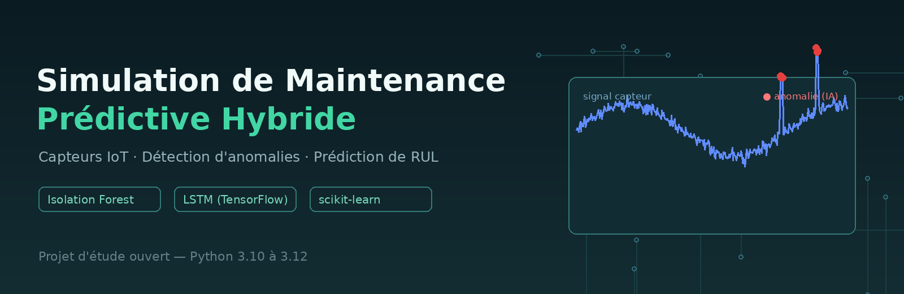
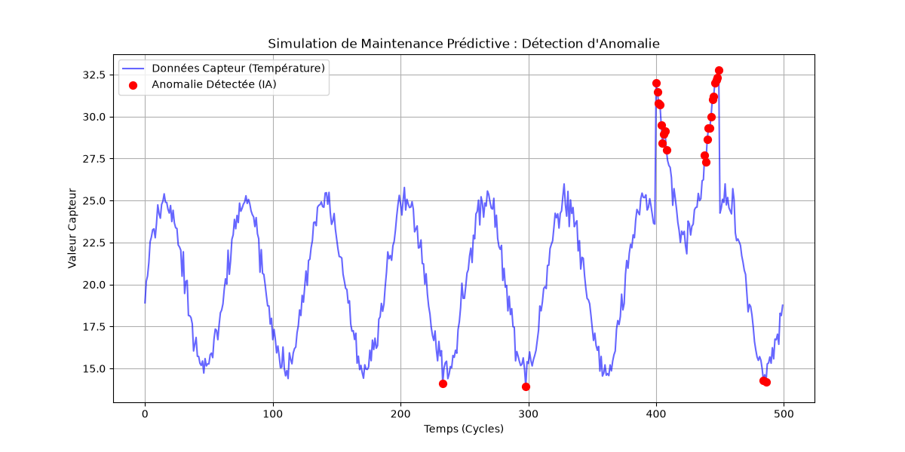
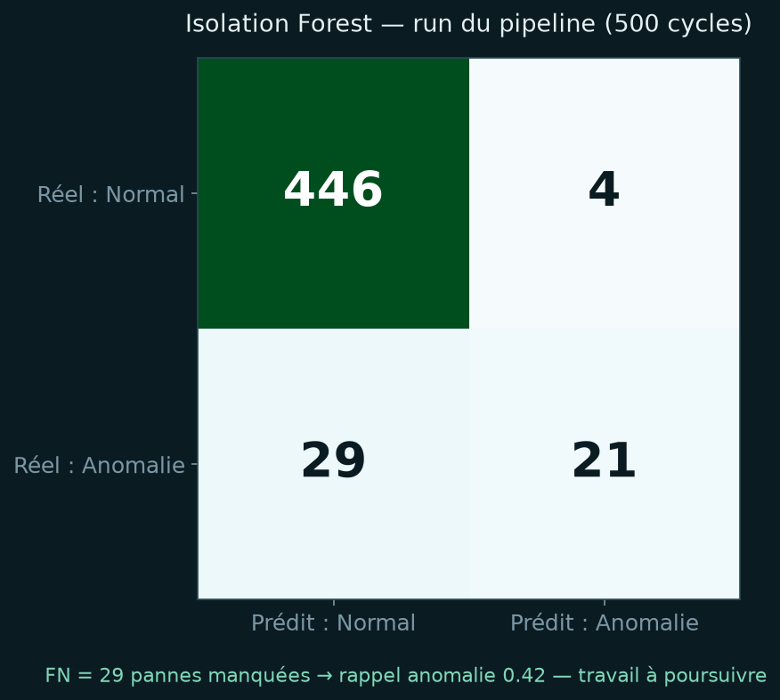

<div align="center">



**A simulated hybrid predictive-maintenance pipeline** — sensor data
generation, anomaly detection and RUL-prediction modeling.

[](https://github.com/bindedouworker-hub/simulation-maintenance-predictive/actions/workflows/python-package.yml)
[](LICENSE)


[English](README.md) · [Français](README.fr.md)

*Personal research project — open to everyone, contributions welcome!*

</div>

---

## 🎯 What it does

This project simulates the **full data pipeline of a predictive-maintenance
system** for IT / electronic equipment (CPU temperature, VCC voltage, fan
speed):

1. **Data generation** — synthetic sensor streams: healthy signal
   (daily cycle + Gaussian noise) with **injected faults** (drift, spikes)
2. **Anomaly detection (unsupervised)** — `IsolationForest` flags
   abnormal windows without any labeled data
3. **Preprocessing for deep learning** — Min-Max normalization +
   sliding-window sequences for time-series modeling
4. **LSTM model (RUL)** — stacked `LSTM → LSTM → Dense` network
   estimating the **Remaining Useful Life** of the component
5. **Evaluation** — confusion matrix, precision/recall/F1, with an eye
   on **false negatives** (missed failures = the costly mistakes)

## 📸 Results preview

Signal + anomalies detected by the Isolation Forest:



Confusion matrix of a recorded full-pipeline run:



Report of the same run (see `results/evaluation_results.txt`):

| | Precision | Recall | F1 |
|---|---|---|---|
| Normal | 0.94 | 0.99 | 0.96 |
| **Anomaly** | **0.84** | **0.42** | **0.56** |

> 93% overall accuracy, but an anomaly recall of 0.42 — exactly the kind
> of honest finding this project is built to surface: unsupervised
> detection alone **misses more than half of the failures**. Growing
> labeled data or a supervised/hybrid scoring stage is the natural next
> step (see [Roadmap](#-roadmap)).

## 🚀 Getting started

```bash
git clone https://github.com/bindedouworker-hub/simulation-maintenance-predictive.git
cd simulation-maintenance-predictive

python -m venv .venv && source .venv/bin/activate
pip install -r requirements.txt
```

Run the full pipeline:

```bash
python scripts/generate_data.py          # 1. synthetic sensor stream
python scripts/maintenance_simulator.py  # 2. IsolationForest detection + plot
python scripts/data_preprocessing.py     # 3. normalization + sliding windows
python scripts/evaluation.py             # 4. confusion matrix + classification report
```

Outputs land in `results/` (CSV stream, text reports, `simulation_plot.png`).

> `scripts/lstm_model.py` defines the RUL network architecture
> (TensorFlow). The rest of the pipeline runs **without TensorFlow**, so
> you can explore detection/evaluation without a heavy install.

## 🗂️ Project structure

```
.
├── data/                       # generated sensor data (demo stream)
├── scripts/
│   ├── generate_data.py        # synthetic sensors (temp CPU, VCC, fan RPM)
│   ├── data_preprocessing.py   # Min-Max + sliding windows for the LSTM
│   ├── lstm_model.py           # stacked LSTM → RUL regression head
│   ├── maintenance_simulator.py# IsolationForest + fault injection + plot
│   ├── evaluation.py           # confusion matrix, precision/recall/F1
│   └── read_results.py         # re-read saved experiment outputs
├── results/                    # CSV / reports / plots from recorded runs
├── notebooks/read_results.ipynb# quick exploration notebook
└── .github/workflows/          # CI: lint + full pipeline smoke test (3.10–3.12)
```

## 🗺️ Roadmap

- [ ] Supervised / hybrid scoring to raise anomaly recall (currently 0.44)
- [ ] Real RUL training loop (`lstm_model.py` currently defines the architecture)
- [ ] Public datasets: NASA C-MAPSS, Microsoft Azure predictive-maintenance
- [ ] Structured logging of runs (`mlflow` or CSV-only experiment tracker)
- [ ] ROC-AUC / PR-AUC curves for threshold-free comparison

## 🤝 Contributing

Everyone is welcome — this is an open study project! Please read
[CONTRIBUTING.md](CONTRIBUTING.md) (short). Open an issue or a PR.

## 📄 License

[MIT](LICENSE) — free to use, modify and share.

---

<div align="center">

**A project by Mr Jackson** 🇨🇮

</div>
